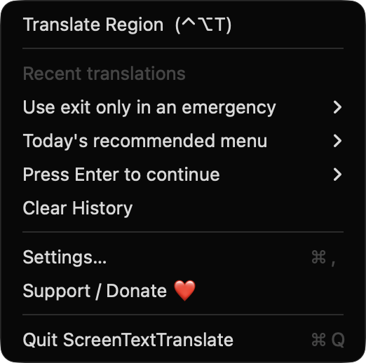
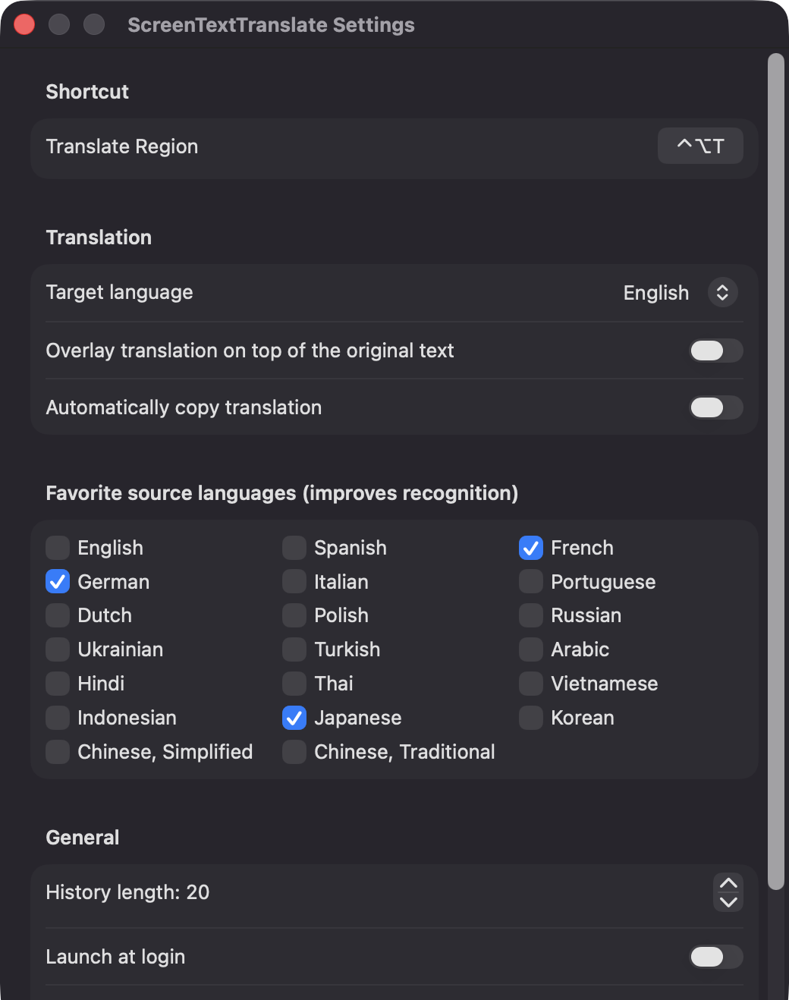
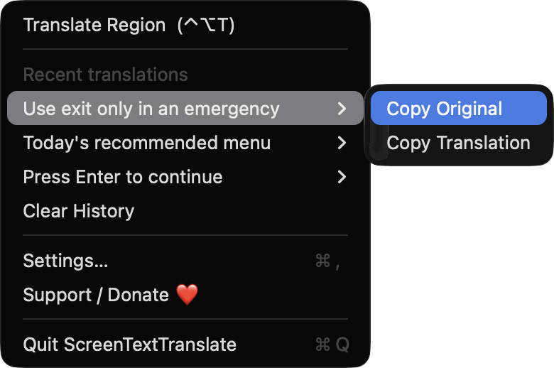

# ScreenTextTranslate

**🌐 Website:** [turhe123.github.io/screen-text-translate](https://turhe123.github.io/screen-text-translate/)

Drag a box over foreign text anywhere on screen and see the translation right there in a floating card.


## Why

ScreenTextTranslate is a free, open-source, 100% native, backend-free alternative to paid utilities in the *Screen & OCR* category. It was inspired by "OCR Quick Translate ($29.99 one-time)", which shows how many people need to read text in videos, games, images, PDFs and apps that can't be selected. Everything here runs on your Mac with Apple's own frameworks: no servers, no accounts, no API keys.

## Features

- **Menu-bar app** (no Dock icon) with Translate Region, a Recent translations list, Settings and Quit.
- **Global hotkey** to start a capture, default ⌃⌥T, re-recordable in Settings (registered via Carbon `RegisterEventHotKey`).
- **Region selection** with a crosshair overlay; Esc cancels at any time.
- **Region capture** with ScreenCaptureKit. The app's own windows are excluded, and regions larger than 3000 px on the long edge are downscaled.
- **On-device OCR** with Vision (accurate level, language correction, automatic language detection). If nothing is found, it retries with a rotated orientation to catch vertical text.
- **Favorite source languages** to bias recognition and language detection.
- **Language detection** with NaturalLanguage, shown as a badge on the card.
- **On-device translation** with Apple's Translation framework (macOS 15+), including the system UI for downloading language packs ("Download Language" button).
- **Floating result card** showing the original text, the translation, a target-language popup, and Copy Original / Copy Translation / Close buttons. It closes on Esc or a click outside.
- **Overlay mode** (macOS 15+): paints the translated lines over a snapshot of the original region.
- **Smart paragraph joining**: wrapped lines are joined with spaces, and a line ending in sentence punctuation starts a new line.
- **Auto-copy** the translation, if you turn it on.
- **History** of recent translations (5–100, default 20) in the menu, stored as a JSON file in Application Support, with copy and clear actions.
- **Launch at login** toggle.
- **Edge cases handled**: a "No text detected" toast that fades after two seconds, skipping translation when the source and target languages match, and a guide to the Screen Recording pane when permission is missing.
- **macOS 14 fallback**: the Translation API needs macOS 15, so on macOS 14 the card shows the recognized text and offers a "Look Up in Dictionary" button, with a notice.
- A **Support / Donate ❤️** button in the menu and in Settings.

## Screenshots

<p align="center"></p>

<p align="center"><em>The menu-bar menu: start a Translate Region capture with ⌃⌥T, browse recent translations, open Settings or support the project.</em></p>

<p align="center"></p>

<p align="center"><em>Settings let you re-record the hotkey, pick a target language, toggle overlay mode and auto-copy, and choose favorite source languages for better recognition.</em></p>

<p align="center"></p>

<p align="center"><em>Each recent translation has a submenu for copying the original text or the translation again.</em></p>

## Install

1. Download `ScreenTextTranslate-macOS.zip` from the [latest release](https://github.com/turhe123/screen-text-translate/releases/latest).
2. Unzip it and move `ScreenTextTranslate.app` to `/Applications`.
3. Because the app is open source and not notarized, clear the quarantine flag:

   ```bash
   xattr -cr /Applications/ScreenTextTranslate.app
   ```

4. The first time, right-click the app and choose **Open**.

## Build from source

Requires Xcode with the macOS 14+ SDK.

```bash
brew install xcodegen
xcodegen generate
xcodebuild -project ScreenTextTranslate.xcodeproj -scheme ScreenTextTranslate -configuration Release -derivedDataPath ./build build
```

The app is produced at `build/Build/Products/Release/ScreenTextTranslate.app`.

## Permissions

- **Screen Recording** (required): needed to capture the region you select so its text can be read. The app asks on first use. If it's denied, a dialog links to System Settings → Privacy & Security → Screen & System Audio Recording. After enabling it, quit and reopen the app.
- **Login item** (optional): only used if you turn on "Launch at login" in Settings.

The app does not request Accessibility or Microphone access, and the global hotkey doesn't need any permission. Captured images are processed in memory and are not saved to disk or sent anywhere.

## Built with AI

ScreenTextTranslate was written by [Claude Code](https://claude.com/claude-code) inside an automated pipeline, from a plain-English spec. No code, binaries or assets from any commercial app were used; it is a clean-room reimplementation of a feature set, not a copy.

What that means in practice:

- The full source is in this repo under the MIT license. Read it before you run it.
- No network calls, no analytics, no third-party dependencies. Only Apple frameworks.
- Ad-hoc signed and not notarized, which is why Gatekeeper warns on first launch.
- It has had less human review than a hand-written app. Bug reports and pull requests are welcome.

## Support ❤️

If this saves you time, you can support the project: [Support Or (Leo) Davidai ❤️](https://ko-fi.com/leodavidai)

## License

MIT © Or Davidai Bachar

## More free Mac apps

Prefer something that runs in the browser? The same pipeline builds [free, private web tools](https://turhe123.github.io/web-tools/): PDF, image, developer, data and audio tools, nothing uploaded.
